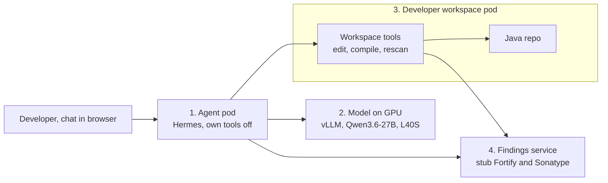

# Agentic remediation lab

An AI agent on Red Hat OpenShift AI triages security scanner findings in a Java repository and, when the developer picks a fix, applies it to the developer's workspace. A fix is kept only if the code compiles and the rescan shows the vulnerability is gone.

## Architecture

1. **Agent pod.** Hermes runs the chat and calls the model. Its own file and terminal tools are off, so it cannot touch the code directly.
2. **Model on GPU.** Qwen3.6-27B served by vLLM on OpenShift AI. Code never leaves the cluster.
3. **Developer workspace pod.** Holds the Java repo and a small tool server, the only way to read or change the code.
4. **Findings service.** A stub that stands in for Fortify and Sonatype: lists findings, rescans files, and records decisions.

## How a fix happens

1. The developer asks the agent to triage a finding. The agent reads the finding and the code, then gives up to three fix options. Nothing changes yet.
2. The developer picks an option. The agent writes the change and sends it to the workspace tools.
3. The workspace tools apply the change, compile, and rescan.
4. If both pass, the change is kept. If not, the file is restored and the agent may try once more before handing the finding back to the developer.
5. The agent records the decision. It never merges; the developer reviews the diff.

## What is real and what is stubbed

| | This lab | The proof of value (POV) |
| --- | --- | --- |
| Scanner | Stub over OWASP BenchmarkJava | Fortify and Sonatype through the scanner partner |
| Developer workspace | DevWorkspace pod, no editor | VS Code in OpenShift Dev Spaces |
| Build | Compile only | Compile plus available tests |
| Handover | Diff in the workspace | Reviewed diff, merged by the developer |

## Repository

| Path | What it is |
| --- | --- |
| `lab/phase2-qwen36-*.yaml` | Model serving with vLLM |
| `lab/stub-findings-mcp/` | Findings service |
| `lab/remote-edit/` | Developer workspace, workspace tools, agent |
| `lab/networkpolicy.yaml` | Network rules |
| `docs/customer/demo-script.md` | Demo walkthrough |

Run `./scripts/scan-secrets.sh` before every commit. Never commit credentials.
