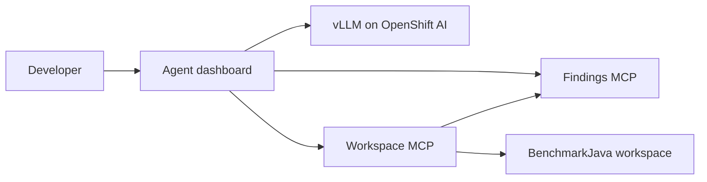
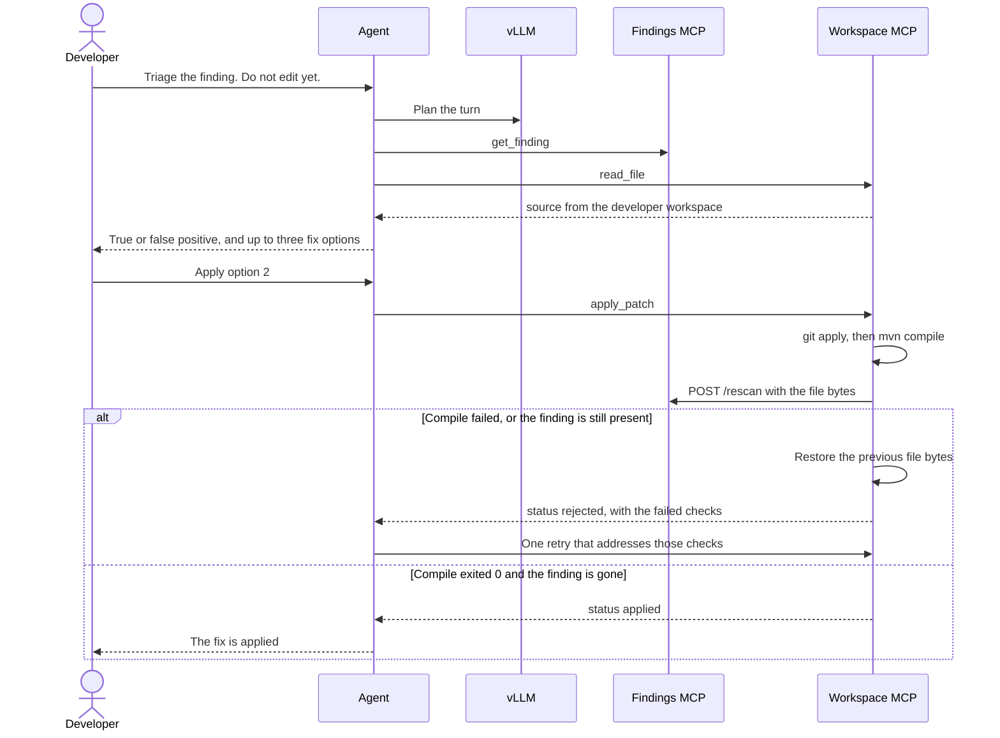
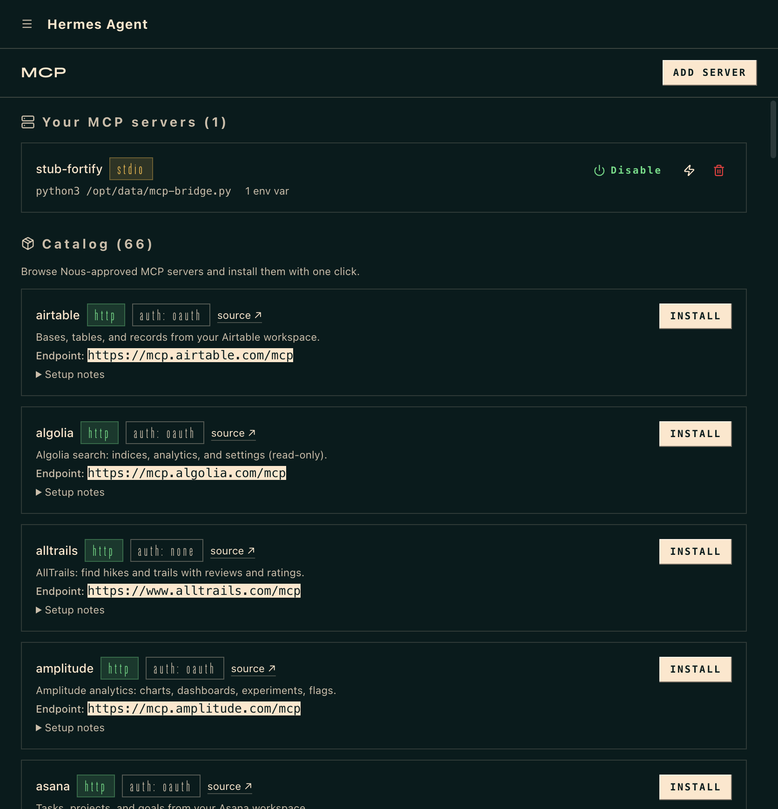
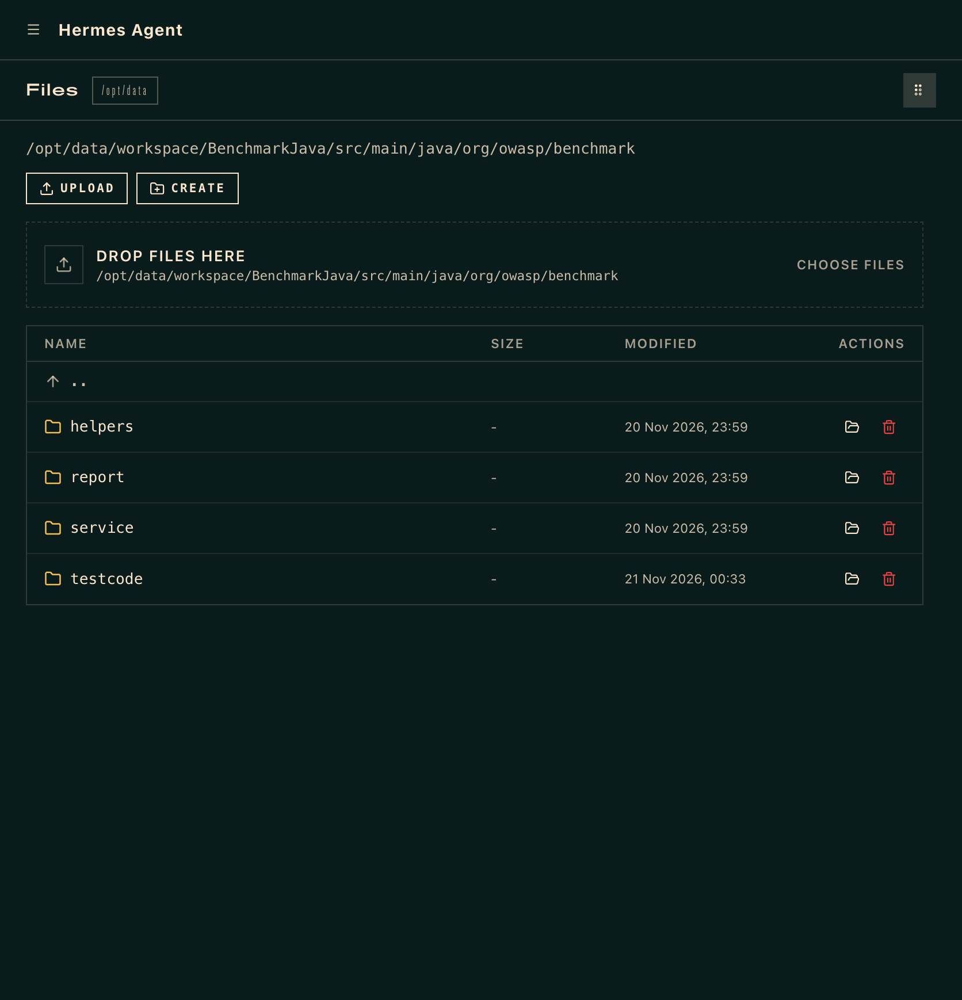
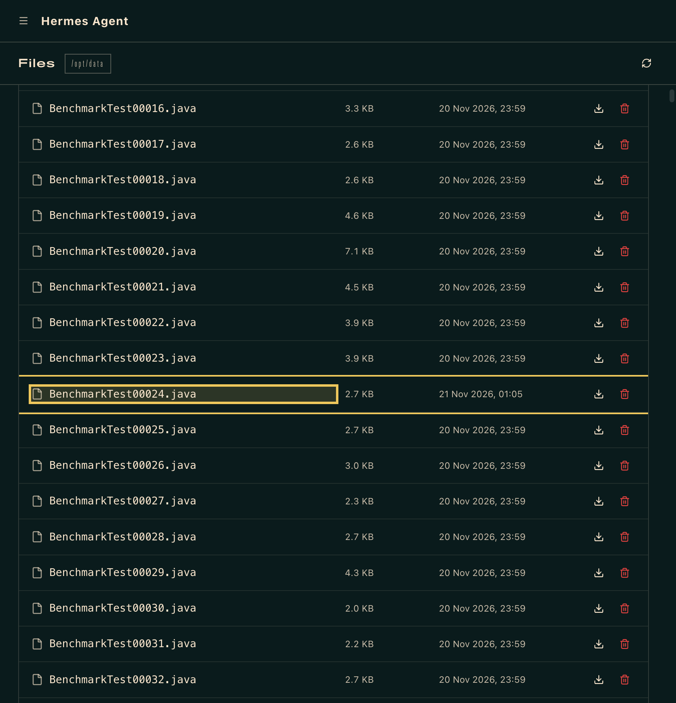

# Agentic remediation lab

A developer asks an agent to triage a scanner finding and, when the finding is real, to patch the code. The agent runs on OpenShift. The model is served by vLLM on OpenShift AI. Findings come from a stub MCP that stands in for Fortify and Sonatype. The source lives in a developer workspace. A patch is kept only after that workspace compiles and the stub says the finding is gone.

The speaker script is [docs/customer/demo-script.md](docs/customer/demo-script.md).

## Architecture



The developer talks only to the agent dashboard. The agent calls the model for each turn. It calls the findings MCP for the finding, the decision, and the rescan. It calls the workspace MCP to read and patch BenchmarkJava. The workspace MCP is the process that compiles and that sends the file bytes back to the findings MCP.

An alternate path gives the agent an SSH shell inside the same workspace. On that path the agent's own file tools stay inside the agent home, and the shell is what changes the remote file. The workspace MCP path is the one that refuses to keep a patch until the compile and the rescan both pass.

## How a request moves



1. The developer asks for a triage and says not to change a file yet. The agent reads the finding and the source, then answers. The workspace checksum stays the same.
2. The developer picks an option. The agent sends one unified diff to `apply_patch`.
3. The workspace MCP applies that diff, runs `mvn -q -DskipTests compile`, reads the changed file, and posts those bytes to `/rescan`.
4. Status `applied` means the compile exited 0 and every rescan reported `still_present` false. Only then may the agent tell the developer the fix is applied.
5. Any other result is status `rejected`. The MCP writes the pre-patch bytes back and returns the failed check names. The agent may try one new diff aimed at those checks.
6. If the second try is also `rejected`, the agent stops and hands the finding back with the reason. A false positive is not patched. A stored-procedure name cannot be bound with `?`, so that finding is handed back the same way.
7. The agent records the decision on the findings MCP. It does not merge.

A kept SQL fix uses the original statement, puts `?` in place of the concatenated value, and binds that value with `PreparedStatement` and `setString`. A `?` inside quotes is not a placeholder. The workspace does not keep that edit.

## What the screen shows

The findings MCP is connected to the agent as `stub-fortify`.



When the BenchmarkJava tree is mounted in the agent pod, the file browser shows the benchmark packages.



The same browser lists the individual test sources the agent reads for a finding.



Those two file views are the copy mounted in the agent pod. The remote workspace is a separate pod. The agent reaches it through the workspace MCP, or through SSH, and does not need that mount.

## Lab and POV

| | This lab | The POV |
| --- | --- | --- |
| Model | Qwen3.6-27B FP8, 128K context, one L40S, served by vLLM | Same model and context, L40S or A100-class |
| Scanner | Stub MCP over a small BenchmarkJava set | Fortify and Sonatype, integration method (MCP or REST) agreed with the scanner partner |
| Rescan | Stub behaviour check. The response includes `still_present`, `checks`, and `stub: true` | Fortify rescan plus human review |
| Build | `mvn -q -DskipTests compile` in the workspace that holds the file | Maven build and the tests that are available |
| Edit | Workspace MCP on a pod the agent does not mount. The tool compiles and rescans before it keeps the patch | Developer workspace, with the same gate |
| Handover | Decision plus diff. The agent does not merge | Reviewed diff in the developer workspace. The agent does not merge |
| Access | Dashboard basic auth, NetworkPolicy, EgressFirewall | Role-based access and network policy, detail agreed at kickoff |
| Library finding | One OpenRewrite `UpgradeDependencyVersion` recipe | Sonatype findings across the repository |

## Repository

| Path | What it is |
| --- | --- |
| `lab/phase2-qwen36-*.yaml` | InferenceService, runtime, and model download for vLLM |
| `lab/stub-findings-mcp/` | Findings catalogue, `/rescan`, and the audit log |
| `lab/build-runner/` | Compile service for a workspace mounted on that pod |
| `lab/hermes/` | Agent dashboard, MCP bridge, and skills |
| `lab/remote-edit/` | Developer workspace, SSH, and the workspace MCP |
| `lab/networkpolicy.yaml` | NetworkPolicy and EgressFirewall for the lab |
| `scripts/scan-secrets.sh` | Fails if a commit would add credentials or cluster identifiers |
| `scripts/score.py` | Scores decisions after a run. The agent never sees the answer key |
| `docs/customer/demo-script.md` | Scene order for the walkthrough |

## Secrets

Copy OpenShift credentials from the RHDP service page. Create the dashboard auth from `lab/hermes/secret.example.yaml`. Do not commit live passwords, keys, or a filled MachineSet. The answer key (`expectedresults*.csv`) is stripped from the workspace and is not an agent input.

```bash
./scripts/scan-secrets.sh
```
